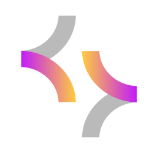

# Koda AI — Decky Loader Plugin

<p align="center">
  
</p>

<p align="center">
  <b>Плагин Decky Loader для Steam Deck</b><br>
  Управление, запуск и интеграция десктопного клиента <b>Kodacode</b> в Game Mode и Desktop Mode со встроенными скиллами для SteamOS.
</p>

<p align="center">
  <a href="https://deckyloader.ru/"></a>
  <a href="https://github.com/Kowalski-coder/koda-ai-plugin/releases"></a>
  <a href="https://gitflic.ru/project/viktorkoval1997/koda-ai-plugin"></a>
  <a href="https://github.com/Kowalski-coder/koda-ai-plugin/blob/main/LICENSE"></a>
  <a href="https://archlinux.org/"></a>
</p>

---

## Возможности

- 🚀 **Установка и запуск в один клик:** Загрузка актуального AppImage Koda Desktop, интеграция в меню приложений KDE и библиотеку Steam (Game Mode).
- 🎮 **Поддержка Game Mode:** Автоматическое создание ярлыка в `shortcuts.vdf` с фирменной иконкой и запуск прямо из оверлея Decky QAM.
- 📊 **Мониторинг квот и лимитов:** Отображение текущего тарифа (Free / Pro) и полос оставшихся вызовов моделей (`Koda base`, `Koda PRO`) с корректным временем сброса по местному часовому поясу.
- 🧩 **Встроенные скиллы для SteamOS:**
  - **SteamOS Core:** системное администрирование, диагностика служб systemd, Flatpak, Game Mode / Desktop Mode.
  - **Proton & PortProton Troubleshooter:** префиксы Wine/Proton, диагностика игр, запуск Windows-приложений.
  - **KDE Plasma Deck:** конфигурация рабочего стола, энергосбережение, сочетания клавиш.
  - **Decky Plugin Dev:** документация и инструментарий для разработки плагинов под Steam Deck.
- 🎨 **Нативный интерфейс Decky:** Монохромная иконка боковой панели QAM, плавный прогресс-бар установки и диалог подтверждения удаления с поддержкой управления с геймпада.

---

## Установка

1. Скачайте актуальный архив **`Koda AI.zip`** из последнего релиза на [GitHub](https://github.com/Kowalski-coder/koda-ai-plugin/releases) или страницы проекта на [GitFlic](https://gitflic.ru/project/viktorkoval1997/koda-ai-plugin).
2. Распакуйте архив в директорию плагинов Decky Loader:
   ```bash
   unzip "Koda AI.zip" -d ~/homebrew/plugins/
   ```
3. Перезагрузите Decky Loader или выполните перезагрузку устройства:
   ```bash
   sudo systemctl restart plugin_loader
   ```
4. Откройте Quick Access Menu (кнопка `...`), перейдите на вкладку плагинов Decky — плагин **Koda AI** готов к работе!

---

## Структура проекта

```text
├── assets/          # Иконки и логотипы Kodacode
├── dist/            # Собранный бандл фронтенда (index.js)
├── skills/          # Встроенные скиллы для Koda Desktop
│   ├── steamos/
│   ├── proton-portproton-troubleshooter/
│   ├── kde-plasma-deck/
│   └── decky-plugin-dev/
├── src/             # Исходный код фронтенда React / TypeScript
│   └── index.tsx
├── main.py          # Бэкенд плагина (Python / Decky Loader API)
├── package.json     # Конфигурация зависимостей и сборки
├── plugin.json      # Манифест плагина Decky Loader
└── rollup.config.js # Конфигурация сборщика Rollup
```

---

## Разработка

Для сборки фронтенда из исходников:

```bash
# Установка зависимостей
npm install

# Сборка плагина
npm run build
```

---

## ☕ Support the Project / Поддержка проекта

Если вам нравится плагин **Koda AI** и вы хотите поддержать дальнейшую разработку и обновления:

<p align="center">
  <a href="https://boosty.to/kowalski1997/donate">
    
  </a>
</p>

<p align="center">
  👉 <b><a href="https://boosty.to/kowalski1997/donate">Поддержать автора на Boosty (Donate)</a></b> 🧡
</p>

---

## Автор и лицензия

- **Автор:** [Kowalski-coder](https://github.com/Kowalski-coder)
- **Зеркало:** [GitFlic](https://gitflic.ru/project/viktorkoval1997/koda-ai-plugin)
- **Лицензия:** BSD 3-Clause
